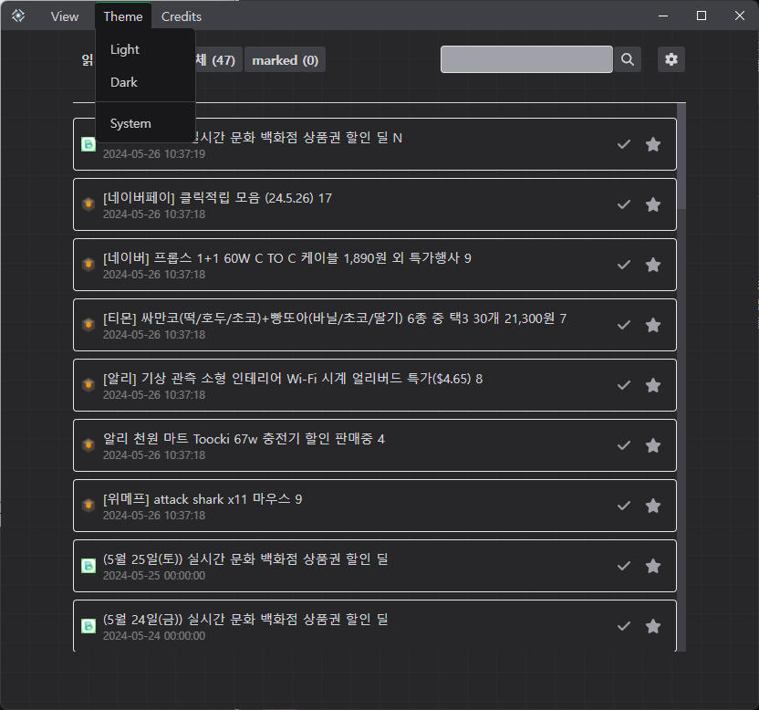
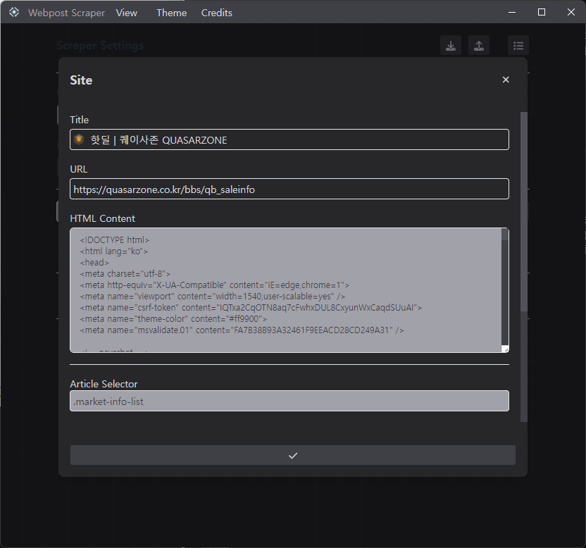

# Webpost Scraper

Webpost Scraper is a Windows-based Electron application designed to collect posts from websites. The primary goal of this project is to develop an Electron application for Windows that can efficiently scrape and collect posts from various websites. This application was inspired by [wepplication tools scrapper](https://wepplication.github.io/tools/scrapper/).

<div style="display: flex; justify-content: space-between;">
  
  
  
</div>

## Getting Started

To get started with Webpost Scraper, follow these steps:

### Prerequisites

- Node.js 22.13 or later (Node.js 24 is used for verification)
- pnpm 12.16.1, as pinned in `package.json`

### Installation

Install the dependencies using pnpm:

```bash
pnpm install
```

The workspace uses the hoisted dependency layout required by Electron Forge and pins SockJS's CommonJS UUID dependency to the patched 11.1.1 release. The application uses React 19, PrimeReact 11 primitives and Tailwind CSS 4.

Type checking uses TypeScript 7.0.2. The `typescript` alias points to Microsoft's latest `@typescript/typescript6` compatibility package because typescript-eslint and ts-loader require the JavaScript compiler API removed in TypeScript 7. The `@typescript/native` alias supplies the TypeScript 7 `tsc` command, following [Microsoft's side-by-side setup](https://devblogs.microsoft.com/typescript/announcing-typescript-7-0/#running-side-by-side-with-typescript-60). The explicit `strict: false` setting preserves the previous compiler defaults, with `noImplicitAny` enabled.

ESLint 10 uses flat configuration. `@eslint/compat` adapts the React and import plugins, whose declared ESLint peer ranges still stop at version 9.

Run `pnpm typecheck`, `pnpm lint` and `pnpm test` before `pnpm package`. Run `node test/runtime-smoke.cjs` against the packaged executable; on Linux use `xvfb-run -a node test/runtime-smoke.cjs`. An optional first argument selects an executable outside `out/`. The smoke test uses a loopback HTTP fixture and isolated databases/profile under `.tmp/`, checks collection, menus, search, themes, error messages and persistence, and leaves diagnostics there. It does not use existing application data.

The Windows Package Check workflow builds the x64 Squirrel installer, runs the packaged application smoke test and uploads the tested installer. Desktop notification delivery and the interactive installer wizard still require manual verification.

### Running the Application

To start the application, use the following command:

```bash
pnpm start
```

### Running the Application on Windows x64

For Windows x64 environments, you can also run the program using the setup file available in the releases section of the GitHub repository. Download the setup file from [here](https://github.com/tinywind/webpost-scraper/releases) and follow the installation instructions.

## Main Features

- **Post Scraping:** Automatically scrape and collect posts from specified websites.
- **Custom Shortcuts:** Support for custom keyboard shortcuts to enhance user experience.
- **Dark Mode:** Utilize `prefers-color-scheme` to enable dark mode.
- **Notification System:** Built-in notifications to alert users of key events or updates.
- **Redux Integration:** State management using Redux to handle application state efficiently.
- **React Router:** Use of `react-router-dom` for routing and navigation within the application.
- **Responsive Design:** Layout adjustments to support different screen sizes and resolutions.
- **Database Integration:** Use of `nedb` (main thread) for persistent storage.

## Frameworks and Libraries

- **Electron:** The main framework for building the cross-platform desktop application.
- **React:** For building the user interface.
- **Redux:** For state management.
- **React Router:** For handling routing within the application.
- **Tailwind CSS:** For styling the application.
- **nedb:** For lightweight database operations in the main process.

## License

This project is licensed under the MIT License.

PrimeReact 11 dependencies use the [PrimeUI License](https://primeui.dev/licenses). Their license terms are separate from this project's MIT license.

## Acknowledgements

This project was created using the [electron-react-webpack-typescript-2024](https://github.com/codesbiome/electron-react-webpack-typescript-2024) template. See the [LICENSE](https://raw.githubusercontent.com/codesbiome/electron-react-webpack-typescript-2024/master/LICENSE) file for details.

## Favicon Copyright Notice

The favicon for this project is used under license from https://www.flaticon.com/. By using the favicon, we agree to the terms outlined at "https://www.freepikcompany.com/legal/#nav-flaticon".
